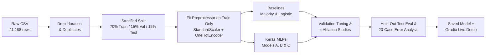

# Bank Marketing Term Deposit Predictor 🏦

[](https://www.python.org/)
[](https://www.tensorflow.org/)
[](https://keras.io/)
[](https://scikit-learn.org/)
[](https://pandas.pydata.org/)
[](https://www.gradio.app/)
[](#-project-roadmap)

> **End-to-End Supervised Deep Learning Pipeline for Imbalanced Tabular Classification**  
> **Bank Marketing Term Deposit Predictor** is a modular Multi-Layer Perceptron (MLP) system built on the **UCI Bank Marketing** dataset (`41,188` records). It predicts whether a retail bank client will subscribe to a term deposit (`y = 1`) using pre-call demographic, campaign, and macroeconomic indicators—combining leak-free preprocessing, class-imbalance mitigation, systematic ablation studies, and a live inference interface.

---

## 📋 Table of Contents
- [Bank Marketing Term Deposit Predictor 🏦](#bank-marketing-term-deposit-predictor-)
  - [📋 Table of Contents](#-table-of-contents)
  - [✨ Key Highlights](#-key-highlights)
  - [🎯 Problem Formulation & Metrics](#-problem-formulation--metrics)
  - [🏗 Architecture & ML Pipeline](#-architecture--ml-pipeline)
    - [Repository Structure](#repository-structure)
    - [End-to-End Pipeline Diagram](#end-to-end-pipeline-diagram)
  - [🚀 Quick Start & Execution](#-quick-start--execution)
    - [Prerequisites](#prerequisites)
    - [1. Clone & Install Dependencies](#1-clone--install-dependencies)
    - [2. Configure Dataset](#2-configure-dataset)
    - [3. Run Training, Evaluation & Demo](#3-run-training-evaluation--demo)
  - [📅 Project Roadmap](#-project-roadmap)
  - [👥 Team Members & Contribution Matrix](#-team-members--contribution-matrix)
  - [🤝 Git Workflow](#-git-workflow)

---

## ✨ Key Highlights

- **Modular Engineering Lifecycle**: Clean separation between data preprocessing (`src/data.py`), neural architectures (`src/models.py`), experiment execution (`src/train.py`), evaluation (`src/evaluate.py`), and single-sample inference (`src/predict.py`).
- **Strict Zero-Leakage Discipline**: Excludes the post-call `duration` feature prior to modeling, enforces stratified `70/15/15` Train/Validation/Test splits before any transformation, and fits `StandardScaler` and `OneHotEncoder` strictly on training folds.
- **Imbalance-Aware Optimization**: Addresses the severe `~88.7% No` vs. `~11.3% Yes` class skew using balanced class weighting and positive-class F1 / Recall / PR-AUC tracking.
- **Progressive MLP Architectures**: Compares trivial and linear baselines against three Keras MLP architectures of increasing complexity, backed by hand-verified parameter counts and a custom `tf.GradientTape` training step.
- **Reproducible Experiment Tracking**: Logs every run, random seed, hyperparameter, and validation metric automatically into `experiments/experiment_log.csv`.

---

## 🎯 Problem Formulation & Metrics

| Component | Specification |
| :--- | :--- |
| **Target User** | Retail bank telemarketing campaign managers prioritizing outbound client calls |
| **Dataset** | [UCI Bank Marketing (`bank-additional-full.csv`)](https://archive.ics.uci.edu/dataset/222/bank+marketing) — `41,188` rows, `19` pre-call features (`duration` dropped) |
| **Input & Output** | Scaled numeric + one-hot encoded categorical vector $\rightarrow$ Single `sigmoid` probability unit |
| **Loss Function** | Binary Cross-Entropy (`binary_crossentropy`) with balanced class weights |
| **Primary Metric** | **Positive-Class F1-Score, Recall & PR-AUC** (preferred over accuracy due to 88.7% majority skew) |
| **Error Cost Trade-off** | False Negatives lose potential term deposit revenue; False Positives cost minor call-agent time |

> [!IMPORTANT]
> **Target Leakage Prevention:** The raw dataset contains a `duration` column (last contact duration in seconds), which is unknown before placing a call and strongly correlates with the target. It is dropped immediately upon loading.

---

## 🏗 Architecture & ML Pipeline

### Repository Structure

```text
bank-marketing-mlp/
├── README.md              # Project overview, setup instructions, and team matrix
├── requirements.txt       # Pinned Python, TensorFlow, and scikit-learn dependencies
├── configs/               # YAML experiment configurations and sample inference payloads
├── data/                  # Dataset setup instructions (raw CSVs excluded via .gitignore)
├── notebooks/             # 01_eda.ipynb (EDA & baselines), 02_results.ipynb (learning curves)
├── src/                   # Core modular Python package
│   ├── data.py            # Leak-free splitting, scaling, encoding, and class weights
│   ├── models.py          # Model A, Model B, Model C architectures & GradientTape step
│   ├── train.py           # Training loop, callbacks, and CSV experiment logger
│   ├── evaluate.py        # Held-out test metrics, confusion matrix, ROC/PR & error analysis
│   └── predict.py         # Single-sample inference pipeline with latency measurement
├── experiments/           # experiment_log.csv and saved training/validation plots
├── models/                # Final saved Keras model (.keras) and fitted preprocessor (.joblib)
├── app/                   # Interactive Gradio live inference web interface
└── report/                # Technical report PDF and presentation slides
```

### End-to-End Pipeline Diagram



---

## 🚀 Quick Start & Execution

### Prerequisites
- **Python 3.10** or **3.11**: `python --version`
- **Git**: `git --version`

### 1. Clone & Install Dependencies
```powershell
git clone https://github.com/tarnished693-max/bank-marketing-mlp.git
cd bank-marketing-mlp
python -m venv .venv
.venv\Scripts\activate
pip install -r requirements.txt
```

### 2. Configure Dataset
1. Download and extract `bank-additional.zip` from the [UCI Machine Learning Repository](https://archive.ics.uci.edu/dataset/222/bank+marketing).
2. Place `bank-additional-full.csv` inside `data/bank-additional-full.csv` (ignored by Git automatically).

### 3. Run Training, Evaluation & Demo
```powershell
# Train an experiment configuration and log validation metrics
python -m src.train --config configs/baseline.yaml

# Evaluate the frozen model on the held-out test set
python -m src.evaluate --model models/final_mlp.keras

# Run single-sample CLI inference or launch the Gradio web demo
python -m src.predict --input configs/sample_client.json
python app/demo.py
```

---

## 📅 Project Roadmap

| Milestone | Target | Deliverables | Status |
| :--- | :---: | :--- | :---: |
| **1. Proposal & Setup** | Week 9 | Problem formulation, dataset validation, primary metric, modular GitHub repo | ✅ **In Progress** |
| **2. EDA & Baselines** | Week 10 | Exploratory data analysis notebook, leak-free splits, trivial & linear baselines | ⏳ Planned |
| **3. Neural Models** | Weeks 11–12 | Models A, B, and C implemented in Keras, hand parameter counts, `GradientTape` | ⏳ Planned |
| **4. Tuning & Ablations** | Week 13 | Hyperparameter studies, 4 ablation experiments, 3-seed run, error analysis | ⏳ Planned |
| **5. Final Delivery** | Week 14 | Tagged `v1.0` repository, technical report PDF, slides, and live demo | ⏳ Planned |

---

## 👥 Team Members & Contribution Matrix (5-Member Squad)

| Team Member | Role & Responsibilities | Assigned Work Packages | GitHub |
| :--- | :--- | :---: | :--- |
| **Yousef Gamal** | **Tech Lead & Baseline/Analysis Engineer** — Repo setup, `configs/`, PR reviews, `01_eda.ipynb`, trivial & linear baselines, Model A, final 3-seed run | **Roles 1 & 3** | [@tarnished693-max](https://github.com/tarnished693-max) |
| **Esraa Gamal** | **Data Engineer** — `src/data.py`, leak-free splits, scaling/encoding, imbalance ablations | **Role 2** | [@esraagamal11mohamed-cell](https://github.com/esraagamal11mohamed-cell) |
| **Jessica Salah** | **Model Architect** — `src/models.py` (Models B & C), hand parameter counts, regularization, `GradientTape` | **Role 4** | [@jessicasaeed12](https://github.com/jessicasaeed12) |
| **Ahmed Abdelsalam** | **Experimentation Engineer** — `src/train.py`, CSV experiment tracking, LR/batch/optimizer studies | **Role 5** | [@ahmdjnydy479-code](https://github.com/ahmdjnydy479-code) |
| **Jana Amr** | **Evaluation & Deployment Engineer** — `src/evaluate.py`, `src/predict.py`, 20-case error analysis, `app/` demo | **Role 6** | [@Janaelsh3rawy](https://github.com/Janaelsh3rawy) |

---

## 🤝 Git Workflow

Direct pushing to the `main` branch is **restricted**. All team members work on isolated feature branches and merge via reviewed Pull Requests:

```powershell
git checkout -b feature/your-feature-name
# Implement and verify your changes
git add .
git commit -m "feat(scope): concise description of changes"
git push origin feature/your-feature-name
# Open a Pull Request on GitHub for peer review
```
