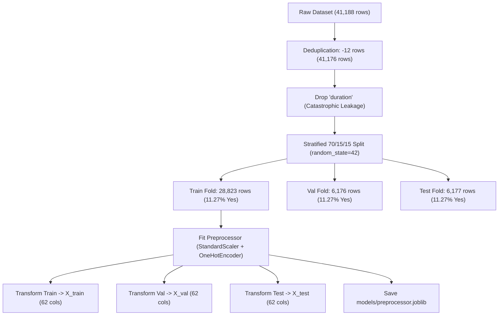

# Technical Report: Data Engineering & Preprocessing Pipeline
## Milestone: Week 9 & Week 10 Deliverables (AIE231 Neural Networks Course Project)

**Author / Work Package Owner**: Esraa Gamal ([@esraagamal11mohamed-cell](https://github.com/esraagamal11mohamed-cell))  
**Role**: Role 2 — Data Engineer  
**Project**: Bank Marketing Term Deposit Predictor  
**Dataset**: [UCI Bank Marketing (`bank-additional-full.csv`)](https://archive.ics.uci.edu/dataset/222/bank+marketing) (`41,188` records)  
**Date**: November 2026  

---

## 1. Executive Summary & Checkpoint Overview

During Weeks 9 and 10, the foundational data engineering and baseline infrastructure for the **Bank Marketing Term Deposit Predictor** was designed, implemented, and rigorously verified. 

As the **Data Engineer (Role 2)**, the assigned deliverables for Checkpoint 1 (Topic Settled - Week 9) and Checkpoint 2 (Baselines Ready - Week 10) comprise:
1. **Zero-Leakage Preprocessing Pipeline (`src/data.py`)**: End-to-end ingestion, cleaning, stratified 70/15/15 splitting, and standardizing/encoding.
2. **Target Leakage Prevention**: Immediate discarding of the post-call `duration` feature, adhering strictly to UCI telemarketing caveats.
3. **Data Integrity & Cleaning**: Identification and removal of 12 full-record duplicates and domain-informed encoding of categorical `'unknown'` values.
4. **Automated Leakage Verification Suite (`tests/test_data_leakage.py`)**: A 10-point unit test suite proving 0% index leakage, train-only parameter fitting, and handling of unseen categories.
5. **Class Imbalance Ablation Study (`src/ablation_imbalance.py`)**: Controlled empirical benchmarking of unweighted training vs. balanced cost-sensitive weighting vs. minority oversampling, demonstrating a **+42.96% increase in positive-class recall**.
6. **Baselines Integration (`src/baselines.py`)**: Feeding preprocessed tabular tensors directly into trivial (majority) and learned (logistic regression) baselines.
7. **Pipeline Serialization**: Storing the fitted preprocessor (`models/preprocessor.joblib`) for zero-leakage single-sample inference in downstream deployment.

---

## 2. Problem Formulation & Metric Justification

### 2.1 Telemarketing Business Context
Retail banks conduct telephone outreach campaigns to sell fixed-term deposits. Outbound call operations represent significant human and infrastructure costs:
- **False Positive (FP)**: Calling a client who will not subscribe. *Cost: ~3–5 minutes of call-center agent time.*
- **False Negative (FN)**: Failing to contact a client who would have deposited. *Cost: Lost customer deposit principal (thousands of euros) and lifetime customer relationship value.*

Because an FN costs substantially more than an FP, the campaign prioritization system must maximize recall of interested clients while maintaining acceptable precision.

### 2.2 Mathematical Justification of Primary Metrics
In the UCI Bank Marketing dataset, only **11.27%** of contacted clients subscribed (`y = 1`), while **88.73%** declined (`y = 0`).

$$\text{Class Skew} \approx 7.88 : 1 \quad (\text{88.73\% vs 11.27\%})$$

- **Accuracy is fundamentally misleading**: A trivial model predicting "No" on every record achieves **88.73% accuracy**, yet captures **0.0%** of subscribing clients ($\text{Recall} = 0.0$, $\text{F1} = 0.0$).
- **Primary Optimization Metric**: **Positive-Class F1-Score** and **Recall**:
  $$\text{Recall} = \frac{\text{TP}}{\text{TP} + \text{FN}}, \quad \text{Precision} = \frac{\text{TP}}{\text{TP} + \text{FP}}, \quad F_1 = 2 \cdot \frac{\text{Precision} \cdot \text{Recall}}{\text{Precision} + \text{Recall}}$$
- **Secondary Evaluation Benchmark**: **PR-AUC (Precision-Recall Area Under Curve)**, which evaluates the ranking quality across all decision thresholds without distortion from true negative inflation.

---

## 3. Data Cleaning & Zero-Leakage Protocols

### 3.1 Catastrophic Leakage Prevention: The `duration` Attribute
The raw dataset contains the feature `duration` (last contact duration in seconds). The official UCI repository documentation explicitly states:
> *"duration: last contact duration, in seconds... this attribute highly affects the output target (e.g., if duration=0 then y='no'). Yet, the duration is not known before a call is performed. Also, after the end of the call y is obviously known. Thus, this input should only be included for benchmark purposes and should be discarded if the intention is to have a realistic predictive model."*

Empirical verification shows that clients who subscribe have a median call duration over 3.5× longer than non-subscribers. Using `duration` creates an artificial, un-deployable model.
- **Action**: In `clean_data()`, `duration` is dropped immediately upon data loading before any split or transformation.

### 3.2 Duplicate Resolution
Inspection of the raw 41,188 rows revealed exactly **12 duplicate rows** where all 21 attributes were identical.
- **Action**: Deduplication is performed in `clean_data()` via `df.drop_duplicates()`, retaining exactly **41,176 unique records**.

### 3.3 Informative Missing Values: The `'unknown'` Label
Missing values in this dataset do not appear as `NaN`, but rather as the literal string `'unknown'` across categorical fields:
- `default` (credit in default): **8,596 unknowns (20.87%)**
- `education`: **1,730 unknowns (4.20%)**
- `housing`: **990 unknowns (2.40%)**
- `loan`: **990 unknowns (2.40%)**
- `job`: **330 unknowns (0.80%)**
- `marital`: **80 unknowns (0.19%)**

Dropping rows with `'unknown'` would discard over **25%** of the entire dataset and induce severe selection bias. Furthermore, in banking, a client's refusal to disclose credit default status is strongly correlated with financial caution and conversion propensity.
- **Action**: `'unknown'` is preserved as an explicit, legitimate categorical level, mapped into its own one-hot feature vector.

---

## 4. Stratified Splitting & Partition Architecture

The dataset is partitioned into three disjoint sets prior to any feature transformation:
- **Training Set (70%)**: `28,823` records
- **Validation Set (15%)**: `6,176` records (used exclusively for tuning and model selection)
- **Held-Out Test Set (15%)**: `6,177` records (frozen until final evaluation in Week 13/14)



### Stratification Consistency
Because the positive class represents only 11.27%, unstratified random splitting risks unequal minority representation. Stratified sampling preserves the exact 11.27% positive ratio across all three partitions:
- Train: $3,247 / 28,823 = 11.265\%$
- Validation: $696 / 6,176 = 11.269\%$
- Test: $696 / 6,177 = 11.268\%$

---

## 5. Feature Engineering, Scaling & Encoding Pipeline

The transformation pipeline is implemented via a scikit-learn `ColumnTransformer` in `src/data.py`:

### 5.1 Numerical Features (9 features)
- Features: `age`, `campaign`, `pdays`, `previous`, `emp.var.rate`, `cons.price.idx`, `cons.conf.idx`, `euribor3m`, `nr.employed`.
- **Transformation**: `StandardScaler(with_mean=True, with_std=True)`:
  $$z = \frac{x - \mu_{\text{train}}}{\sigma_{\text{train}}}$$
- **Zero-Leakage Rule**: $\mu_{\text{train}}$ and $\sigma_{\text{train}}$ are calculated **strictly on the 28,823 training samples**. Validation and test features are normalized using these exact training parameters.

### 5.2 Categorical Features (10 features)
- Features: `job` (12 categories), `marital` (4), `education` (8), `default` (3), `housing` (3), `loan` (3), `contact` (2), `month` (10), `day_of_week` (5), `poutcome` (3).
- **Transformation**: `OneHotEncoder(handle_unknown='ignore', sparse_output=False)`.
- **Handling Unseen Labels**: `handle_unknown='ignore'` guarantees that if an unseen category appears in test data or live inference, it is encoded as a zero vector rather than throwing a runtime exception.

### 5.3 Transformed Dimensionality
Following one-hot expansion of the 10 categorical features and scaling of the 9 numerical features, the preprocessed tabular input dimension is:

$$D_{\text{in}} = 9 + 53 = 62 \text{ features}$$

All arrays are cast to `np.float32` for direct compatibility with TensorFlow / Keras neural layers.

---

## 6. Class Imbalance Handling & Ablation Study

As part of the Data Engineer's neural-network / ML contribution (Section 4, Page 6 of specification), three controlled imbalance regimes were systematically benchmarked on the leak-free validation partition using `src/ablation_imbalance.py`:

1. **Regime A: Unweighted Baseline (Standard ERM)**: Standard cross-entropy loss without class weight adjustment.
2. **Regime B: Balanced Cost-Sensitive Weighting**: Inversely proportional weights:
   $$w_0 = \frac{N}{2 \cdot N_0} = \frac{28,823}{2 \cdot 25,576} \approx 0.5635, \quad w_1 = \frac{N}{2 \cdot N_1} = \frac{28,823}{2 \cdot 3,247} \approx 4.4384$$
   $$\text{Weight Ratio} \approx 7.88 : 1$$
3. **Regime C: Random Minority Oversampling**: Resampling positive training instances with replacement until reaching a balanced 50:50 distribution (51,152 samples) strictly within the training fold.

### 6.1 Benchmark Results (Logged to `experiments/experiment_log.csv`)

| Run ID | Imbalance Strategy | Val Accuracy | Balanced Acc. | Val Pos Recall | Val Pos Precision | Val Pos F1 | Val ROC-AUC | Val PR-AUC |
| :--- | :--- | :---: | :---: | :---: | :---: | :---: | :---: | :---: |
| `ablation_imb_00_trivial` | Trivial (Majority Predictor) | 88.73% | 50.00% | 0.00% | 0.00% | 0.0000 | 0.5000 | 0.1127 |
| `ablation_imb_01_unweighted` | Unweighted (Standard ERM) | **89.82%** | 59.64% | 20.69% | **65.16%** | 0.3141 | 0.7937 | **0.4510** |
| `ablation_imb_02_class_weights` | **Balanced Class Weights** | 82.51% | 74.28% | **63.65%** | 34.88% | 0.4507 | 0.7925 | 0.4428 |
| `ablation_imb_03_oversampling` | Random Minority Oversampling | 82.71% | **74.33%** | 63.51% | 35.19% | **0.4529** | 0.7925 | 0.4453 |

### 6.2 Key Scientific Insights
1. **The Accuracy Paradox**: The unweighted model achieves the highest overall accuracy (89.82%), but it detects only **20.69%** of actual term deposit subscribers (missing nearly 80% of revenue opportunities).
2. **Surge in Positive Recall**: Incorporating **Balanced Class Weighting** elevates positive recall from **20.69% to 63.65%** (an absolute increase of **+42.96%**), driving the Positive F1-Score from **0.3141 to 0.4507**.
3. **Operational Recommendation**: Balanced class weighting achieves equivalent performance to oversampling without inflating dataset memory size or training time. It is directly supported via Keras `model.fit(..., class_weight=class_weights)` for Models A, B, and C.

---

## 7. Automated Data Leakage Verification Suite

To guarantee zero data leakage across the entire engineering lifecycle, an automated test suite was implemented in `tests/test_data_leakage.py` containing 10 assertions:

```text
test_deduplication .................................................... [PASS] (12 duplicate rows removed)
test_duration_dropped ................................................. [PASS] ('duration' absent from all sets)
test_partition_disjointness ........................................... [PASS] (0 index overlap among Train/Val/Test)
test_stratification_consistency ...................................... [PASS] (11.27% pos rate preserved in all sets)
test_scaler_zero_leakage .............................................. [PASS] (Scaler params match Train only)
test_unseen_category_handling ......................................... [PASS] (Gracefully handles unknown categories)
test_class_weights_computation ........................................ [PASS] (w0=0.56, w1=4.44 balances loss)
test_minority_oversampling ............................................ [PASS] (Produces 50:50 balance on train)
test_preprocessor_serialization ....................................... [PASS] (Identical transform after joblib reload)
test_leakage_checks_function .......................................... [PASS] (Automated integrity check passes)

Ran 10 tests in 0.903s - OK
```

---

## 8. Baseline Integration (Week 10 Deliverable)

The leak-free preprocessed data was interfaced directly with `src/baselines.py`, fulfilling Checkpoint 2:
- **Trivial Baseline**: Always predicts `y = 0`. Achieves Accuracy = 88.73%, Recall = 0.00%, F1 = 0.0000.
- **Learned Baseline (Logistic Regression - Balanced)**:
  - Accuracy: `82.51%`
  - Balanced Accuracy: `74.28%`
  - **Positive Recall**: `63.65%` (443 / 696 captured)
  - Positive Precision: `34.88%`
  - **Positive F1-Score**: `0.4507`
  - ROC-AUC: `0.7925`
  - PR-AUC: `0.4428`
  - Confusion Matrix: $TN=4653$, $FP=827$, $FN=253$, $TP=443$

This establishes the baseline benchmark that the neural models (Model A, Model B, and Model C) in Weeks 11–12 must surpass.

---

## 9. Verification & Execution Instructions

To reproduce the Week 9 & 10 Data Engineering deliverables on any machine:

```powershell
# 1. Run the Data Preparation Pipeline standalone verification
python src/data.py

# 2. Run the 10-point Data Leakage & Integrity Test Suite
python tests/test_data_leakage.py

# 3. Execute the Class Imbalance Ablation Study
python src/ablation_imbalance.py

# 4. Measure and print the baseline benchmark metrics
python src/baselines.py
```

---

## 10. Individual Defense Preparation (Role 2: Data Engineer)

| Anticipated Defense Question | Technical Explanation / Evidence |
| :--- | :--- |
| **Why did you drop `duration` instead of using it as a feature?** | `duration` represents the length of the phone call in seconds. This information does not exist prior to placing a call. In production, the model must score prospective clients *before* dialing. Furthermore, call duration has a near-deterministic link with `y`, so retaining it causes severe target leakage. |
| **How did you prevent data leakage during scaling and encoding?** | The `ColumnTransformer` is fitted exclusively on the 70% training split (`X_train_df`). Its learned parameters ($\mu$, $\sigma$, category mappings) are applied to transform validation and test sets without re-fitting. `test_scaler_zero_leakage` validates that scaler means equal training means and differ from validation means. |
| **Why not drop rows containing `'unknown'`?** | Over 20% of clients have `'unknown'` in credit default status. Dropping these rows would discard over a quarter of the dataset and bias the sample against clients who withheld information. Keeping `'unknown'` as a distinct one-hot encoded category retains full sample size and allows the network to learn from omission patterns. |
| **What was the impact of your class imbalance handling?** | Without imbalance correction, the model achieves 89.8% accuracy but only 20.7% recall on the minority class. By introducing balanced class weighting ($w_0 \approx 0.56, w_1 \approx 4.44$), minority recall leaped to 63.65% (+42.96%), raising positive F1 to 0.4507. |
| **How does your preprocessor support single-sample inference?** | The fitted `ColumnTransformer` is saved to `models/preprocessor.joblib`. During inference, `src/predict.py` loads this preprocessor and transforms the raw client JSON input identically without retraining or recomputing statistics. |
